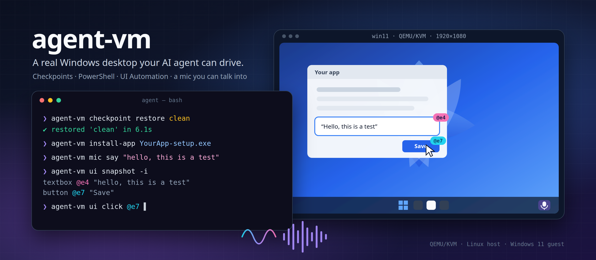
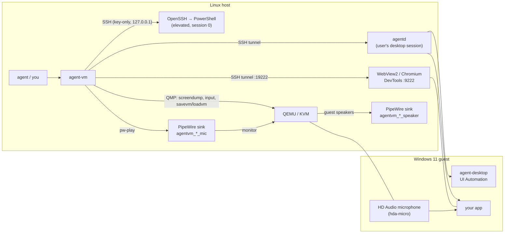

<p align="center">
  
</p>

<p align="center">
  <a href="https://github.com/klang-ai/agent-vm/actions/workflows/ci.yml"></a>
  <a href="https://www.npmjs.com/package/@klang-ai/agent-vm"></a>
  
  
  <a href="LICENSE"></a>
</p>

# agent-vm

**A real Windows desktop that your AI agent can drive from the outside.**

`agent-vm` is a command-line tool for Linux hosts. It builds a Windows 11 virtual machine with no
clicks, then gives an agent such as Claude Code, Codex or your own scripts everything it needs to
develop and test software on that machine:

- **Lifecycle and checkpoints.** One command installs Windows unattended. Snapshots of the full
  machine (memory and disk) restore in seconds, so every test starts from the same state.
- **Shell and files.** Elevated PowerShell over SSH, `push`/`pull`, and silent installs of
  `.exe` and `.msi` files.
- **The real desktop session.** Commands run where a signed-in user's apps actually live:
  visible windows, focus and UI Automation.
- **Semantic UI control.** [`agent-desktop`](https://github.com/vercel-labs/agent-desktop) runs
  inside the guest: `snapshot -i` lists every control with an `@ref`, and `click @e7` acts on it.
- **Web views over DevTools.** WebView2, Electron and Tauri apps expose DevTools, and
  [`agent-browser`](https://github.com/vercel-labs/agent-browser) drives them through an SSH tunnel.
- **A microphone you can talk into.** `agent-vm mic say "hello"` speaks into Windows' default
  microphone, and `agent-vm speaker` records what Windows plays. Voice and dictation features can
  be tested without a human in the loop.
- **Host-side eyes and hands.** Screenshots, keystrokes and clicks through QEMU's monitor. They
  work with no guest software at all: on the login screen, during setup, or when the guest is
  wedged.

It was built to port and test a dictation app on Windows from a Linux workstation. Nothing in it
is specific to that app.

```console
$ agent-vm create win11                    # ~30 min, unattended, once
$ agent-vm checkpoint restore clean        # seconds
$ agent-vm install-app ./MyApp-setup.exe
$ agent-vm launch 'C:\Users\agent\AppData\Local\MyApp\MyApp.exe'
$ agent-vm ui snapshot -i                  # UI Automation tree with @refs
$ agent-vm mic say "hello, this is a test"
$ agent-vm ui get text @e4
$ agent-vm screenshot after.png
```

---

## Contents

- [Why](#why)
- [How it works](#how-it-works)
- [Requirements](#requirements)
- [Install](#install)
- [Quick start](#quick-start)
- [Commands](#commands)
- [The fake microphone](#the-fake-microphone)
- [Checkpoints](#checkpoints)
- [Using it from an agent](#using-it-from-an-agent)
- [Recipes](#recipes)
- [Troubleshooting](#troubleshooting)
- [Security model](#security-model)
- [FAQ](#faq)
- [Development](#development)
- [Credits](#credits)

## Why

Agents are good at writing code and poor at proving it works on an operating system they cannot
see. Cloud Windows runners can't speak into a microphone. Remote desktops need a person to click.
Screenshot-only "computer use" is slow and guesses at pixels.

`agent-vm` gives the agent a local Windows machine that is:

- **Deterministic.** Restore the same checkpoint before every run.
- **Observable.** It reads the accessibility tree, DevTools and logs instead of guessing from pixels.
- **Fully scriptable.** No step in the loop needs a person, including speech.
- **Fast.** KVM speed, an SSH command in about 20 ms, and a restore in seconds.

## How it works



**Two ways in, on purpose.** An SSH session on Windows runs outside the user's desktop. It is
great for installing things and reading files, but UI Automation sees nothing there, and programs
it starts stay invisible. So the guest also runs **agentd**, a small Node service started by a
logon task in the user's own session. `exec --desktop`, `launch`, `install-app` and `ui` go
through agentd. agentd listens only on the guest's loopback interface, is reached through the SSH
tunnel, and requires a per-VM random token.

**No guest required for the basics.** Screenshots, keyboard and mouse go through QEMU's QMP
socket, as do checkpoints.

**Audio is plumbing, not a driver.** QEMU exposes an Intel HD Audio codec (`hda-micro`), which
Windows sees as a normal _Microphone_ and _Speakers_. On the host each VM gets two PipeWire null
sinks. The guest's microphone records the monitor of `agentvm_<vm>_mic`. The guest's speakers play
into `agentvm_<vm>_speaker`. Anything played into the first sink is heard by Windows. Nothing from
the VM ever reaches your real speakers, and your real microphone is never connected.

**Unattended install.** `create` downloads the pinned Windows 11 Enterprise evaluation ISO and the
[virtio-win](https://github.com/virtio-win/virtio-win-pkg-scripts) drivers. It writes an
`autounattend.xml` (disk layout, drivers, local admin account, autologon, no OOBE) onto a small
ISO, together with the OpenSSH installer and your public key. Then it boots. On first logon,
Windows installs OpenSSH, and `agent-vm` takes over over SSH to install Node.js, ffmpeg,
agent-desktop and agentd. It finishes by saving a checkpoint named `clean`.

## Requirements

|                  |                                                                                                                                                                                                                                                                  |
| ---------------- | ---------------------------------------------------------------------------------------------------------------------------------------------------------------------------------------------------------------------------------------------------------------- |
| Host OS          | Linux x86_64 with KVM (`/dev/kvm` readable and writable by you)                                                                                                                                                                                                  |
| CPU / RAM / disk | VT-x/AMD-V, ~8 GB RAM free for the VM, ~40 GB disk (ISOs, disk, checkpoints)                                                                                                                                                                                     |
| Packages         | `qemu-system-x86`, `qemu-utils`, `ovmf`, `xorriso`, `openssh-client`, `curl`, PipeWire with `pipewire-pulse` (`pactl`, `pw-play`, `parecord`)                                                                                                                    |
| Node.js          | 22 or newer                                                                                                                                                                                                                                                      |
| Optional         | `espeak-ng` or [piper](https://github.com/OHF-Voice/piper1-gpl) (natural voices) for `mic say`, `ffmpeg` to play mp3 and other formats, `virt-viewer` for `view`, `swtpm` for `--tpm`, [`agent-browser`](https://github.com/vercel-labs/agent-browser) for `web` |

Debian/Ubuntu:

```sh
sudo apt install qemu-system-x86 qemu-utils ovmf xorriso openssh-client curl \
  pipewire-pulse pulseaudio-utils espeak-ng virt-viewer
sudo usermod -aG kvm "$USER"    # then log out and in
```

`agent-vm doctor` checks all of this and tells you what is missing.

## Install

```sh
npm install -g @klang-ai/agent-vm
agent-vm doctor
```

## Quick start

```sh
# 1. Build the VM: downloads ~6 GB the first time, then installs Windows unattended.
agent-vm create win11 --cpus 8 --memory 12

# 2. See it (optional, for humans).
agent-vm view

# 3. Drive it.
agent-vm exec 'Get-ComputerInfo | Select-Object OsName, OsVersion'
agent-vm launch notepad.exe
agent-vm ui snapshot -i --app notepad
agent-vm ui type @e3 "Written by an agent"
agent-vm screenshot notepad.png

# 4. Go back to a pristine machine whenever you like.
agent-vm checkpoint restore clean
```

`create` takes 15 to 40 minutes, depending on disk and CPU. It prints progress, and you can watch
with `agent-vm view`. Everything lives in `~/.agent-vm` (override with `AGENT_VM_HOME`).

## Commands

Every command accepts `--vm <name>`. The default is `$AGENT_VM`, or the only VM if there is one.
`--json` prints machine-readable output.

### Lifecycle

| Command                 | What it does                                                                                                                                                                                                                                                                                                                  |
| ----------------------- | ----------------------------------------------------------------------------------------------------------------------------------------------------------------------------------------------------------------------------------------------------------------------------------------------------------------------------- |
| `create [name]`         | Download, install unattended, bootstrap, and save checkpoint `clean`. Options: `--cpus` (default 4), `--memory <GB>` (8), `--disk <GB>` (80), `--resolution` (1920x1080), `--iso <path>` with `--product-key` for retail media, `--locale` (en-US), `--time-zone` (UTC, Windows id e.g. `"W. Europe Standard Time"`), `--tpm` |
| `up [-c <checkpoint>]`  | Start the VM (optionally from a checkpoint) and wait until SSH and the desktop agent answer                                                                                                                                                                                                                                   |
| `down [-f]`             | ACPI shutdown, or `--force` to stop QEMU immediately                                                                                                                                                                                                                                                                          |
| `status` / `list`       | State, reachability, ports and checkpoints                                                                                                                                                                                                                                                                                    |
| `view`                  | Open a SPICE viewer (`remote-viewer` or `spicy`)                                                                                                                                                                                                                                                                              |
| `install` / `bootstrap` | Resume an interrupted `create` / re-run guest tooling setup                                                                                                                                                                                                                                                                   |
| `destroy <name>`        | Delete the VM, its checkpoints and its audio sinks                                                                                                                                                                                                                                                                            |
| `doctor`                | Check host requirements and VM health                                                                                                                                                                                                                                                                                         |

### Inside the guest

| Command                                           | What it does                                                                                                             |
| ------------------------------------------------- | ------------------------------------------------------------------------------------------------------------------------ |
| `exec <ps…>`                                      | PowerShell over SSH (elevated, no desktop). Exit code and output pass through                                            |
| `exec --desktop <ps…>`                            | PowerShell in the user's desktop session. `--detach`, `--timeout <s>`                                                    |
| `ssh`                                             | Interactive PowerShell                                                                                                   |
| `push <local> <remote>` / `pull <remote> <local>` | Copy files (use forward slashes: `C:/Users/agent/Desktop/`)                                                              |
| `install-app <file>`                              | Copy an installer in and run it silently as the desktop user (`/S` for `.exe`, `/qn` for `.msi`; override with `--args`) |
| `launch <exe> [args…]`                            | Start a program on the desktop. `--cdp [port]` turns on WebView2 DevTools, `-e KEY=VALUE` sets env vars                  |
| `hosts <name…>`                                   | Resolve these names to the host from inside the guest (for dev servers on the host)                                      |
| `trust-ca <pem>`                                  | Trust a root CA in the guest, e.g. `"$(mkcert -CAROOT)/rootCA.pem"`                                                      |

### Seeing and touching

| Command                     | What it does                                                                                                                                                                                                                       |
| --------------------------- | ---------------------------------------------------------------------------------------------------------------------------------------------------------------------------------------------------------------------------------- |
| `ui <agent-desktop args…>`  | Run [agent-desktop](https://github.com/vercel-labs/agent-desktop) in the desktop session: `snapshot -i`, `click @e3`, `type @e5 "text"`, `get text @e4`, `wait --window …`, `list-windows`, … See `agent-vm ui skills get desktop` |
| `web <agent-browser args…>` | Run [agent-browser](https://github.com/vercel-labs/agent-browser) against DevTools in the guest (after `launch --cdp`)                                                                                                             |
| `screenshot [file]`         | Full-screen PNG from the host                                                                                                                                                                                                      |
| `key <combo…>`              | Keystrokes from the host: `win+r`, `ctrl+alt+delete`, `enter`                                                                                                                                                                      |
| `type <text>`               | Type ASCII from the host keyboard (US layout)                                                                                                                                                                                      |
| `click <x> <y>`             | Click screen pixels from the host. `--button right`, `--double`                                                                                                                                                                    |

### Audio

| Command                       | What it does                                                              |
| ----------------------------- | ------------------------------------------------------------------------- |
| `mic say <text…>`             | Text-to-speech into the guest microphone. `--lang en/sv/da/no/de`         |
| `mic play <file>`             | Play an audio file into the guest microphone                              |
| `speaker <out.wav> [-s secs]` | Record what the guest plays                                               |
| `level <file.wav>`            | RMS / peak / dBFS of a WAV file. Exits 3 if it is silent (handy in tests) |

### Checkpoints

| Command                             | What it does                                                                        |
| ----------------------------------- | ----------------------------------------------------------------------------------- |
| `checkpoint save <name>`            | Snapshot memory and disk of the running VM                                          |
| `checkpoint restore <name>`         | Return to it (starts the VM if needed), fix the guest clock, and wait for readiness |
| `checkpoint list` / `delete <name>` | Manage them                                                                         |

## The fake microphone

```sh
agent-vm mic say "The quick brown fox"           # English
agent-vm mic say --lang sv "Hej, hur mår du?"     # Swedish
agent-vm mic play ./fixtures/meeting.flac         # any recording
```

- Windows sees an ordinary **Microphone (High Definition Audio Device)** as its default input.
  Your app needs no test mode: WASAPI, DirectShow, Media Foundation and browsers all just hear it.
- `mic say` uses **piper** if it is on your `PATH` (it downloads a natural voice per language into
  the cache on first use) and **espeak-ng** otherwise. Speech recognisers understand piper much
  better. Install it with `pipx install piper-tts`.
- Audio plays in real time. `mic say` returns when the sentence has been spoken.
- To check what Windows actually heard, record inside the guest and measure it:

  ```sh
  agent-vm exec --desktop --detach 'ffmpeg -y -f dshow -i audio="Microphone (High Definition Audio Device)" -t 6 C:/agent-vm/heard.wav'
  agent-vm mic say "testing one two three"
  agent-vm pull C:/agent-vm/heard.wav heard.wav && agent-vm level heard.wav
  ```

## Checkpoints

Checkpoints are QEMU internal snapshots stored in the VM's qcow2 disk. They capture **memory and
disk**, so a restore brings back running apps, open windows and a signed-in session exactly as
they were. Restoring takes a few seconds. `agent-vm` then corrects the guest clock through the
QEMU guest agent and reconnects SSH.

Good habits:

- Keep `clean` untouched and build on top of it: `clean` → `app-installed` → `signed-in`.
- Restore before each test, not after, so a failed run leaves its state behind for inspection.
- Checkpoints use disk space roughly equal to guest RAM in use. `checkpoint delete` frees it.

To make checkpoints possible, every device in the VM is migratable. That is why the CPU uses
explicit Hyper-V enlightenments instead of `hv-passthrough`, and the UEFI variable store is qcow2.

## Using it from an agent

The package ships a skill for coding agents at
[`skills/agent-vm/SKILL.md`](skills/agent-vm/SKILL.md). It covers the observe → act → verify
loop, which channel to use for what, and the gotchas. For Claude Code:

```sh
mkdir -p ~/.claude/skills && ln -s "$(npm root -g)/@klang-ai/agent-vm/skills/agent-vm" ~/.claude/skills/agent-vm
```

Rules of thumb for agents:

1. `checkpoint restore` first, so you know the starting state.
2. Use `ui snapshot -i` and `web snapshot -i` to observe. Screenshots are for humans and for
   proving a result.
3. Act on `@refs`. Take a new snapshot after anything that changes the UI.
4. Verify through a second channel (`ui get`, a log file over `exec`, a WAV `level`) before
   claiming success.

## Recipes

<details>
<summary><b>Install a build and smoke-test it</b></summary>

```sh
agent-vm checkpoint restore clean
agent-vm install-app dist/MyApp_1.2.3_x64-setup.exe
agent-vm exec 'Get-AuthenticodeSignature "$env:LOCALAPPDATA/MyApp/MyApp.exe" | Format-List Status, SignerCertificate'
agent-vm launch "C:/Users/agent/AppData/Local/MyApp/MyApp.exe"
agent-vm ui wait --window "MyApp" --timeout 20000
agent-vm screenshot first-launch.png
```

</details>

<details>
<summary><b>Test dictation end to end</b></summary>

```sh
agent-vm checkpoint restore signed-in
agent-vm launch notepad.exe && agent-vm ui wait --window Notepad
agent-vm key ctrl+shift+space              # your app's dictation hotkey
agent-vm mic say "Meeting notes. Ship the Windows build on Friday."
agent-vm key ctrl+shift+space
agent-vm ui snapshot -i --app notepad      # assert the text landed
```

</details>

<details>
<summary><b>Drive a WebView2 / Electron / Tauri UI through DevTools</b></summary>

```sh
agent-vm launch --cdp "C:/Users/agent/AppData/Local/MyApp/MyApp.exe"
agent-vm web snapshot -i
agent-vm web click @e12
agent-vm web eval "document.title"
```

</details>

<details>
<summary><b>Point the guest at dev servers on the host</b></summary>

From the guest, `10.0.2.2` is the host's loopback. Map your dev hostnames to it and trust your
local CA:

```sh
agent-vm hosts dev.app.example.test dev.api.example.test
agent-vm trust-ca "$(mkcert -CAROOT)/rootCA.pem"
```

</details>

<details>
<summary><b>Record system audio the app plays</b></summary>

```sh
agent-vm speaker out.wav --seconds 8 &
agent-vm exec --desktop '(New-Object Media.SoundPlayer "C:/Windows/Media/Alarm01.wav").PlaySync()'
wait; agent-vm level out.wav
```

</details>

## Troubleshooting

| Symptom                                              | Fix                                                                                                                                                                                                 |
| ---------------------------------------------------- | --------------------------------------------------------------------------------------------------------------------------------------------------------------------------------------------------- |
| `create` sits on "still installing" for over an hour | `agent-vm view` or `agent-vm screenshot`. A product key prompt means a retail ISO: pass `--product-key`.                                                                                            |
| `/dev/kvm usable: FAIL`                              | `sudo usermod -aG kvm $USER` and log in again, or enable virtualization in firmware.                                                                                                                |
| `ui …` says the desktop agent is unreachable         | Is anyone signed in? Autologon can be broken by changing the password. `agent-vm bootstrap` reinstalls agentd.                                                                                      |
| `mic say` is silent in the guest                     | `pactl list short sinks \| grep agentvm` should show two sinks. `agent-vm up` recreates them after a host reboot. Check that Windows' default input is "Microphone (High Definition Audio Device)". |
| Text from `type` comes out wrong                     | Host typing assumes a US layout in the guest. Use `ui type @ref "…"` for anything else.                                                                                                             |
| Clock is wrong after a restore                       | The guest agent corrects it; if `qemu-ga` is not running, `agent-vm exec 'w32tm /resync'`.                                                                                                          |
| Windows says the evaluation expired                  | The evaluation lasts 90 days. `agent-vm exec 'slmgr /rearm'` and reboot (works a few times), or recreate the VM.                                                                                    |

## Security model

- The VM only listens on **127.0.0.1**: SSH, SPICE and the forwarded ports. Nothing is exposed
  to your network.
- SSH accepts **only the agent-vm key** (`~/.agent-vm/id_ed25519`). Password login is disabled
  after setup.
- The guest account (`agent` / `agent-vm`) is a local administrator with autologon. It exists so
  the machine is usable unattended. Treat the VM as a disposable test machine, not a place for real
  credentials.
- agentd binds to the guest's loopback interface and requires a random per-VM token
  (`~/.agent-vm/vms/<name>/agentd.token`, mode 600).
- Guest audio goes to private null sinks. Your real microphone is never attached to the VM.
- Downloads are pinned to official sources: Microsoft, the Fedora virtio-win mirror, the
  PowerShell OpenSSH releases, nodejs.org and BtbN FFmpeg builds.

## FAQ

**Is the Windows license OK?** `create` installs the free **Windows 11 Enterprise Evaluation**,
which Microsoft offers for testing. It runs for 90 days and can be re-armed. Bring your own ISO
and key with `--iso` and `--product-key` for anything else.

**macOS or Windows hosts?** Not yet. The design (QEMU + QMP + SSH + agentd) carries over;
Hypervisor.framework/HVF and audio routing are the work. Contributions welcome.

**Linux guests?** The command surface is OS-agnostic. A Linux guest needs a different installer
and bootstrap. It is planned.

**Why not Docker images of Windows?** They are great for viewing, but they hide QEMU. agent-vm
needs QMP for checkpoints and input, a microphone device, and a guest-side agent in the user's
session.

**Can several VMs run at once?** Yes. Each gets its own ports and audio sinks. Select one with
`--vm`.

## Development

```sh
git clone https://github.com/klang-ai/agent-vm && cd agent-vm
npm install
npm run check        # eslint (strict, type-checked) + prettier + tsc + tests
node dist/cli.js doctor
```

- `src/`: the CLI (TypeScript, one dependency: commander).
- `src/test/`: unit tests on `node:test`, including fake QMP and guest-agent servers.
- `guest/windows/`: what runs inside Windows: `firstboot.ps1`, `bootstrap.ps1`, `agentd.mjs`.
  CI checks them with PSScriptAnalyzer.
- Releases: bump `version`, push tag `vX.Y.Z`. CI publishes to npm with provenance through
  trusted publishing, so no tokens are stored in the repository.

Tests that need a real VM are deliberately not in CI. Before a release, run through the
[quick start](#quick-start) and the dictation recipe on a fresh `create`.

## Credits

- [QEMU](https://www.qemu.org/), [OVMF](https://github.com/tianocore/edk2) and
  [virtio-win](https://github.com/virtio-win/virtio-win-pkg-scripts) do the heavy lifting.
- The unattended answer file started from [quickemu](https://github.com/quickemu-project/quickemu)'s (MIT).
- [agent-desktop](https://github.com/vercel-labs/agent-desktop) and
  [agent-browser](https://github.com/vercel-labs/agent-browser) by Vercel Labs provide the
  `@ref` UI control that `ui` and `web` wrap.
- [piper](https://github.com/OHF-Voice/piper1-gpl) and [espeak-ng](https://github.com/espeak-ng/espeak-ng) give the microphone its voice.

Made by [Klang](https://klang.ai). Licensed under [Apache-2.0](LICENSE).
